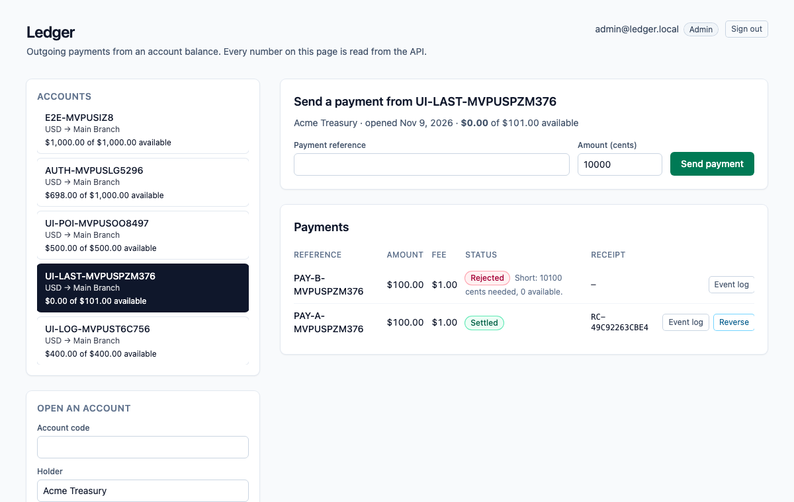
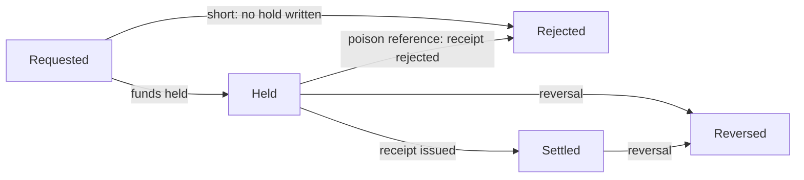
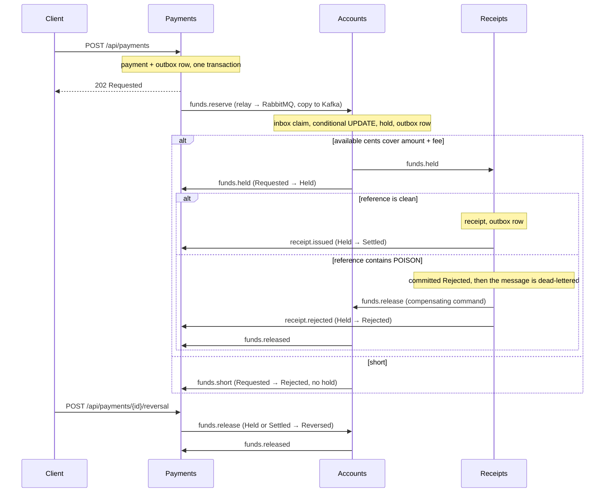

# dotnet-ledger

Outgoing payments from an account balance. The scarce number is the **available cents** of an account, and the **Accounts** module is its only writer: it holds the amount plus fee with a single conditional `UPDATE` that matches only while the available cents still cover the debit, so when two payments fight for the last funds, one commits a hold and the other is short and writes none. A payment reference that contains the poison token `POISON` is committed as rejected by the Receipts module, the message is dead-lettered, and a compensating command gives the funds back. A later reversal also gives the funds back, but it does not roll back the receipt that was already issued.

One ASP.NET Core process, one Postgres database. An HTTP write saves the payment and an outbox row in one local transaction; a `BackgroundService` relay publishes outbox rows to RabbitMQ (the work queue) and Kafka (the event log); the next module consumes from RabbitMQ, claims an inbox key in the same transaction as its own write, and writes its own row and outbox row. Saga steps never call each other in-process. Delivery is at-least-once: the relay can publish and crash before it marks a row sent, so the row goes out again, and every consumer dedupes with its inbox key. Each saga step only moves a payment forward from the status it expects.

> The Compose network is local and unauthenticated. There is no login, no token and no cookie. Do not publish these ports; Compose binds all of them to `127.0.0.1`.



*The UI reads everything from the API. Shown: a settled payment, a reversal that gave the funds back and kept its receipt, a payment rejected for the poison token, and one that was short.*

## Money

All amounts are whole cents in a `long`. The fee is a flat 50 cents plus 0.5% of the amount, truncated to a whole cent, so a $1,000.00 payment costs $5.50 in fees. A payment is 1 to 5,000,000 cents ($50,000.00). The hold is the amount plus the fee. Fee arithmetic is `checked`: it throws instead of wrapping.

## Payment statuses



`Reversed` and `Rejected` (after a hold) give the funds back through a `ReleaseFunds` command, and Accounts releases a hold at most once. The receipt has its own status (`Issued` or `Rejected`) and a reversal never changes it. If the reversal gets there before the final mark, the late mark finds the payment is no longer `Held` and does nothing.

## How the modules talk



| Module | Owns | Consumes | Emits |
| --- | --- | --- | --- |
| **Payments** (`Modules/Payments`) | `Payments`: status, amount, fee, reference. Validation, the poison rule, the fee. | `funds.held`, `funds.short`, `receipt.issued`, `receipt.rejected`, `funds.released` | `funds.reserve`, `funds.release` (reversal) |
| **Accounts** (`Modules/Accounts`) | `Accounts.AvailableCents` (sole writer after the account opens) and `FundHolds`. | `funds.reserve`, `funds.release` (prefetch 1) | `funds.held`, `funds.short`, `funds.released` |
| **Receipts** (`Modules/Receipts`) | `Receipts`. | `funds.held` | `receipt.issued`, `receipt.rejected`, `funds.release` (poison) |
| **Messaging** (`Messaging`) | `OutboxMessages`, `InboxMessages`, the relay, the consumer loop with retry and dead-letter, the Kafka log. | | |

RabbitMQ topology is declared in code (`Messaging/Topology.cs`): exchange `ledger.work`, one queue per module (`accounts.commands`, `receipts.work`, `payments.events`), a `.retry` queue per module (2 s TTL, then back to the main queue, 3 attempts), and a `.dlq` per module behind `ledger.dlx`. A transient failure retries; a poison message goes straight to the dead-letter queue after its rejection is committed. Kafka has one topic, `ledger.events`, one partition, replication factor 1, keyed by payment id.

## Run it

Needs Node 22 (npm 10), .NET SDK 10.0.401 (`global.json`), Docker (arm64 is fine) and python3 for the smoke script.

```bash
npm ci
docker compose up -d --wait db        # dotnet test uses Postgres on 5472 (database ledger_test)
dotnet test tests/api/Ledger.Api.Tests.csproj
docker compose up --build --wait      # db, kafka, rabbitmq, api, web
./scripts/smoke.sh                    # last line: ledger smoke passed
npx playwright install chromium       # once
npx playwright test                   # one spec against http://127.0.0.1:8092
docker compose down                   # keeps the Postgres volume; `down -v` drops it
```

| Service | Host port |
| --- | --- |
| Web (nginx, proxies `/api/`) | 8092 |
| API (`/scalar/v1`, `/api/health`) | 5212 |
| Postgres 17 | 5472 |
| Kafka 3.8.1 (KRaft, one broker) | 9122 |
| RabbitMQ 3.13 / management UI (`platform` / `platform`) | 5702 / 15702 |

Inside the Compose network the API and nginx listen on 8080 and Kafka's internal listener is 9092.

## Try it with curl

```bash
curl -s -X POST http://127.0.0.1:5212/api/accounts \
  -H 'content-type: application/json' \
  -d '{"code":"ACME-USD-1","holder":"Acme Treasury","currency":"USD","branch":"Main Branch","openingCents":100000}'

curl -s -X POST http://127.0.0.1:5212/api/payments \
  -H 'content-type: application/json' \
  -d '{"accountCode":"ACME-USD-1","reference":"INV-1001","amountCents":30000}'
# 202, status Requested, feeCents 200. Use the returned id:

curl -s http://127.0.0.1:5212/api/payments/<id>             # Settled after a few seconds, with a receipt number
curl -s http://127.0.0.1:5212/api/receipts/<id>
curl -s http://127.0.0.1:5212/api/accounts/ACME-USD-1       # availableCents 69800
curl -s http://127.0.0.1:5212/api/payments/<id>/events      # the Kafka log for this payment

curl -s -X POST http://127.0.0.1:5212/api/payments/<id>/reversal \
  -H 'content-type: application/json'                       # funds come back; the receipt stays
```

A payment is validated at the door: reference required (at most 40 characters), 1 to 5,000,000 cents. The poison match is a case-sensitive substring: `INV-POISON-7` and any longer token containing `POISON` match.

## Develop with Nx

The repository is an Nx workspace (`nx.json`, plugin `@nx/dotnet`). `npx nx show projects` lists `api` (the ASP.NET Core monolith), `web` (the Angular app) and the inferred xUnit project.

```bash
docker compose up -d --wait db kafka rabbitmq   # the brokers and Postgres, not the app
npx nx serve api                                # http://localhost:5212
npx nx serve web                                # http://localhost:4292, proxies /api to the API
WEB_URL=http://localhost:4292 npx playwright test   # the same browser specs, against the dev servers
npx nx run-many -t typecheck lint -p web        # tsc --noEmit and ESLint (angular-eslint)
npx nx build web && npx nx build api            # what CI builds
```

## What is tested, and where it runs

- **xUnit against real Postgres** (`tests/api`, 26 tests): two tasks with two `DbContext`s fight for funds that cover only one payment (one `Held`, one `Short`, available 0, no hold for the loser); empty input, over-limit input, integer overflow (including `long.MaxValue`, and fee arithmetic that must throw rather than wrap), the fee, the poison substring; the same message delivered twice is claimed once; a release returns the funds once; the poison rejection is committed before the dead-letter; a reversal followed by the late final mark leaves the payment `Reversed` and the receipt `Issued`. The race test was run against a read-then-write version of the debit, where it failed, and against the conditional update, where it passes.
- **`scripts/smoke.sh`** drives the composed stack with a run id on every code, so a kept volume does not collide: validation, the happy path (fee, receipt, Kafka log), three concurrent payments against funds that cover one (one settled, two short, no hold for the losers), the poison reference (rejected, `receipts.work.dlq` gains one message, funds restored), and a reversal that lands between the receipt and the final mark (payment `Reversed`, receipt `Issued`, funds back, second reversal `409`). To make that last window wide enough to hit on purpose, Compose sets `Payments__FinalMarkDelayMs=1500`; it is a latency knob and defaults to 0.
- **Playwright** (`e2e/specs/send-payment.spec.ts`): opens an account in the UI, sends a payment, sees `Settled`, the receipt number and the new balance, reloads to prove the page reads the API and keeps nothing in `localStorage`, then reverses and sees the balance come back. It runs against the composed web port. A second spec, `e2e/specs/ui-flows.spec.ts`, drives the page through the refusal messages (over-limit, empty reference, duplicate), the poison rejection, the loser of a race for the last of the scarce number, and the Kafka event log panel. Both specs pass against the Compose stack and against the Nx dev servers.
- **CI** (`.github/workflows/ci.yml`, on push) has two jobs. `verify`: `npm ci`, Prettier check, `dotnet format whitespace --verify-no-changes`, `dotnet test` with a Postgres 17 service, `nx typecheck` and `nx lint` for web (ESLint with angular-eslint, template accessibility rules included, zero warnings allowed), and `nx build` for web and api. `e2e`: builds the Compose stack on the runner, runs `scripts/smoke.sh` and both Playwright specs against it, uploads the Playwright traces and prints the Compose logs on failure.

## API

All routes are unauthenticated JSON. Interactive docs are at `http://127.0.0.1:5212/scalar/v1` (OpenAPI at `/openapi/v1.json`); the web port proxies `/api/`, `/scalar/` and `/openapi/` too.

| Method and path | What it does | Responses |
| --- | --- | --- |
| `GET /api/health` | Liveness. | `200 Healthy` |
| `POST /api/accounts` | Opens an account with an opening balance in cents. | `201`, `400` invalid, `409` code exists |
| `GET /api/accounts` | Lists accounts. | `200` |
| `GET /api/accounts/{code}` | One account with the live available cents. | `200`, `404` |
| `POST /api/payments` | Accepts a payment (1 to 5,000,000 cents) and starts the saga. | `202` Requested, `400` invalid, `404` unknown account, `409` duplicate reference |
| `GET /api/payments?accountCode=` | Lists the latest 100 payments, optionally for one account. | `200` |
| `GET /api/payments/{id}` | One payment and its status. | `200`, `404` |
| `POST /api/payments/{id}/reversal` | Moves a held or settled payment to `Reversed` and gives the funds back. The receipt is not touched. | `202`, `404`, `409` wrong status |
| `GET /api/payments/{id}/events` | The Kafka event log for one payment, read from the start of the topic. | `200` |
| `GET /api/receipts/{paymentId}` | The receipt row. | `200`, `404` until the step has run |

Errors come back as `application/problem+json` with a `title`.

## Configuration

Compose sets these on the API container. Defaults in `apps/api/appsettings.json` point at the published host ports, so `nx serve api` works against `docker compose up -d --wait db kafka rabbitmq`.

| Setting | Compose value | Meaning |
| --- | --- | --- |
| `ConnectionStrings__Ledger` | `Host=db;Port=5432;Database=ledger;Username=ledger;Password=ledger` | The one Postgres database. Migrations run on startup. |
| `RabbitMq__Host` / `__Port` / `__User` / `__Password` | `rabbitmq` / `5672` / `platform` / `platform` | Work queue. Virtual host `/`. |
| `Kafka__BootstrapServers` | `kafka:9092` | Event log. |
| `Payments__FinalMarkDelayMs` | `1500` | Milliseconds the final mark waits. A latency knob so the smoke can land a reversal inside the window. `0` outside Compose. |
| `LEDGER_TEST_DB` (tests only) | | Postgres connection for `dotnet test`. Defaults to `localhost:5472`, database `ledger_test`. CI points it at its service container. |

## Look inside and fix things

```bash
docker compose ps                      # five services, all healthy
docker compose logs -f api             # relay, consumers, poison and retry lines
docker compose exec db psql -U ledger -d ledger -c 'select "RoutingKey","SentAt" from "OutboxMessages" order by "Id" desc limit 10'
open http://127.0.0.1:15702            # RabbitMQ management, platform / platform
```

- **Dead-lettered messages** sit in `receipts.work.dlq`. Nothing replays them; inspect them in the management UI. Retries wait in `<queue>.retry` for 2 seconds.
- **A port is already in use**: `lsof -nP -i :5212` shows who holds it. Compose publishes only on `127.0.0.1`.
- **`dotnet test` cannot connect**: start Postgres first with `docker compose up -d --wait db`.
- **The smoke cannot reach the API**: run `docker compose up --build --wait` first; override the target with `API=... RABBIT=... ./scripts/smoke.sh`.
- **Start clean**: `docker compose down -v` drops Postgres, Kafka and RabbitMQ data. Plain `down` keeps them, and the smoke is safe on kept data because every code carries a run id.
- **The Kafka log looks empty right after a payment**: the relay publishes within a second or so; reload the event log.

## Known limits

- It is unauthenticated on purpose. Anything that can reach the API can read and write everything.
- There are no deposits or transfers in: an account's balance only goes down through holds and back up through releases. The scarce-number mechanics are the point, not a full ledger.
- Delivery is at-least-once, not exactly-once. The inbox makes repeats harmless for the saga; the Kafka log can hold a duplicate event after a relay crash.
- One broker, one partition, replication factor 1, one API instance. The relay does not coordinate across instances (the inbox would absorb the duplicates, but the outbox is never trimmed).
- `GET .../events` scans the whole topic for each call. Fine here, not something to expose at scale.
- Lists are capped at 100 rows and not paginated.
- Dead-lettered messages are not replayed automatically.
- The browser specs drive Chromium at a desktop size only, and the `e2e` CI job needs Docker and takes a few minutes.

## Cloud mapping

This repository runs on Compose. Nothing in it calls a cloud account. There is no Pub/Sub client in the process.

| Here | On Google Cloud |
| --- | --- |
| Postgres 17 | Cloud SQL for PostgreSQL |
| Kafka 3.8 | A Pub/Sub topic or managed Kafka |
| RabbitMQ 3.13 | A Pub/Sub subscription with a dead-letter topic |
| The API and the web app | Cloud Run |

## Layout

```
apps/api      ASP.NET Core monolith: Modules/{Payments,Accounts,Receipts}, Messaging, Data, Migrations
apps/web      Angular 21, styled with Tailwind 4 utilities only
tests/api     xUnit against Postgres
e2e/          Playwright
scripts/      smoke.sh
compose.yaml  Postgres, Kafka, RabbitMQ, API, web
```

Nx 23.2.1 orchestrates `nx build web` and `nx build api`; EF Core migrations are committed and the API applies them on startup.

## Other systems in this .NET track

- [dotnet-freight](https://github.com/joshbarros/dotnet-freight): container space on ocean sailings.
- [dotnet-clinic](https://github.com/joshbarros/dotnet-clinic): appointment slots in a provider session.
- [dotnet-warehouse](https://github.com/joshbarros/dotnet-warehouse): warehouse stock and outbound orders.
- [dotnet-academy](https://github.com/joshbarros/dotnet-academy): course cohort seats and enrollments.
